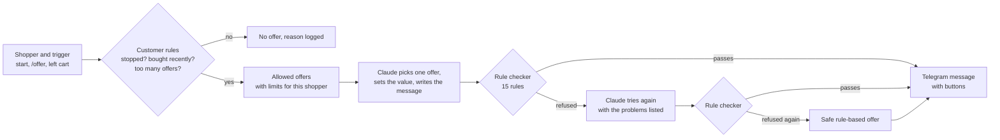

# Peshkash: Personalised Offer Engine

Peshkash (Hindi/Punjabi for "offer") decides **which offer each customer of an online store should get, and when**,
and delivers it through a Telegram bot. The marketing team sets the rules; an AI agent (Claude) chooses and writes
each offer inside those rules; **every AI choice is checked against the rules before it is sent**.

- **Telegram bot:** [@BazaarKartOffers_bot](https://t.me/BazaarKartOffers_bot)
- **Store:** BazaarKart, a made-up Indian online marketplace (fashion, electronics, beauty, home, grocery, sports)
- **Data:** 2,000 synthetic shoppers. No real customer data is used anywhere.

Built for Hackathon 2, Punjab Jobs AI Bootcamp (J-PAL South Asia), with Claude Code. Project notes for Claude Code
are in [CLAUDE.md](CLAUDE.md).

---

## Try it

### The bot
1. Open [@BazaarKartOffers_bot](https://t.me/BazaarKartOffers_bot) and tap **Start**.
2. Pick **English, हिंदी or ਪੰਜਾਬੀ**. You get a made-up shopper to play (their city, orders, favourite categories,
   points and cart), then an offer picked for that shopper, with **Claim offer / Not now / Stop offers** buttons.
3. Try the commands:

| Command | What happens |
|---|---|
| `/offer` | Ask for another offer. Usually refused politely: the rules wait 3 days between offers. |
| `/newprofile` | Play a different shopper and get an offer for them. |
| `/shop` | Add items to a cart. Leave the cart for 2 minutes and a cart reminder arrives. |
| `/profile` | See your shopper again. |
| `/stop` | Stop all offers (send `/start` to turn them back on). |
| `/language` | Change language. |

Offers asked for between 9 pm and 9 am wait until morning (quiet hours). That is a rule, not a bug.

### The marketer page
While the bot runs, it also serves a page for the marketing team: the bot's live results, the decision log and the
rules (which the bot uses from its next decision). Locally it is at **http://localhost:8010**; when hosted, it asks
for a password.

### The clickable prototype
Double-click `prototype/index.html`. It runs entirely in the browser (no setup) on 1,500 made-up shoppers, with a
simulated AI, so you can explore segments, change rules, run a campaign and compare strategies.

---

## How it works



1. **Rules decide who may get an offer at all**: not if they stopped offers, bought in the last 3 days, return more
   than 40% of their orders, already got 2 offers this week, or got one in the last 3 days.
2. **Rules decide which offers are allowed** for this shopper's segment, with limits (for example "at most 20% off,
   and never below a 10% margin").
3. **Claude chooses inside those limits.** It sees the shopper's history and only the allowed offers, picks one,
   sets the value and writes two lines in the shopper's language, with a one-sentence reason for marketers. It answers
   in a fixed JSON format, so the answer can always be read.
4. **The rule checker has the final say.** Every choice is built into a real offer and checked against all 15 rules.
   If it breaks one, Claude gets one retry with the problems listed; if it still fails, or Claude can't be reached, a
   safe rule-based offer is sent instead. A shopper never receives an offer that breaks a rule.
5. **Everything is logged**: what Claude proposed, what the checker refused, what was sent, and what the shopper did.

---

## What's inside

### Synthetic data that behaves like real shoppers
`backend/peshkash/datagen.py` creates 2,000 shoppers with about 15,000 orders over 18 months, plus browsing, carts,
loyalty points and past offers. Each shopper has a hidden behaviour type (loyal, deal seeker, drifting away, window
shopper, festive-only, lapsed and more) that shapes their history; **the engine never sees it**, it only sees what a
real platform would know. The generator checks itself against nine patterns seen in real Indian e-commerce:

| Check | Result | Expected |
|---|---|---|
| Revenue from the top 20% of customers | 68% | 60–80% |
| Carts left without buying | 77% | 65–80% |
| Diwali month vs an average month | 1.6× | at least 1.5× |
| Orders on salary days (1st–5th) vs other days | 1.29× | above 1.1× |
| Orders at weekends vs weekdays | 1.46× | above 1.1× |
| Cash on delivery, small cities vs big cities | 50% vs 17% | higher in small cities |
| Category with the most returns | Fashion (25%) | Fashion |
| Average order vs typical order | 1.45× | above 1.15× (a few big orders) |
| Signed up but never ordered | 8% | 5–25% |

### Customer segments
From each shopper's orders (how recently, how often, how much, coupon use): **Champions, Loyal, New, Needs attention,
At risk, Lost, Bargain hunters**, plus the live trigger **left a cart**.

### Offers
| Offer | Costs the store | Typically for |
|---|---|---|
| % off a category | discount on the order | At risk, needs attention |
| Flat ₹ off above a minimum order | the flat amount | Bargain hunters |
| Free delivery | delivery cost | Small baskets, smaller cities |
| 2× loyalty points | extra points | Loyal, champions |
| Points expiry reminder | nothing | Anyone with points about to expire |
| Cart reminder (optionally a small discount) | nothing, or a little | Anyone who left a cart |
| Early access to the Diwali sale | nothing | Champions (they'd buy anyway) |
| Win-back discount | discount | Lost customers, one try |
| Welcome offer | a small amount | New customers, second order |

### The 15 rules
All of them are adjustable on the marketer page, with plain-English explanations.

| Customer rules | Offer rules |
|---|---|
| Hasn't stopped offers | Offer type allowed for the segment |
| Didn't buy in the last N days | Discount within the % and ₹ limits |
| Return rate below a limit | Leaves at least the margin floor |
| No more than N offers a week | Fits the campaign budget |
| At least N days since the last offer | Not sent during quiet hours |
| | Expiry date shown and not too long |
| | No banned words ("guaranteed", "free money", ...) |
| | Message not too long |
| | In the shopper's language |
| | **Message matches the offer**: every % and ₹ in the text is one the offer really gives, including any minimum order |

Cart reminders can have their own limit (one per cart), so a shopper who just got an offer can still be reminded about
a cart they left. Marketers can switch this off.

### Is it worth it? (simulation)
The prototype runs the same campaign three ways on 1,500 shoppers, using their hidden behaviour to simulate who buys:
**"20% off for everyone"** loses money (about −₹55,000 profit: most of the discount goes to people who would have
bought anyway), **one offer per segment** earns about ₹47,000, and **AI within the rules** about ₹94,000. A holdout
group that gets nothing shows how much the offers really add, and how sure we can be.

---

## Setup

You need **Python 3.12**, a Telegram bot token (from [@BotFather](https://t.me/BotFather): send `/newbot`) and,
for the AI, an Anthropic API key. Without the key the bot still works with rule-based offers.

```
git clone https://github.com/GurdevKaur24/Personalised-offer-engine.git
cd Personalised-offer-engine
copy .env.example .env          # macOS/Linux: cp .env.example .env
```
Open `.env` and fill in `TELEGRAM_BOT_TOKEN=` and `ANTHROPIC_API_KEY=` (never commit this file; it is git-ignored).

Then, on Windows:
```
cd backend
py -3.12 -m venv .venv
.\.venv\Scripts\python -m pip install -r requirements.txt
.\.venv\Scripts\python -m bot.main
```
On macOS/Linux use `python3.12 -m venv .venv` and `.venv/bin/python` instead.

The first start generates the shoppers (a few seconds), connects to Telegram and prints the bot's link and the
marketer page address (`http://localhost:8010`). Press Ctrl+C to stop.

### Settings
| Setting (in `.env` or the host's environment) | What it does |
|---|---|
| `TELEGRAM_BOT_TOKEN` | Required. The bot's token from BotFather. |
| `ANTHROPIC_API_KEY` | Turns on the AI. Without it, offers are rule-based. |
| `PESHKASH_MODEL` | Claude model. Default `claude-opus-5-5`; `claude-haiku-5-5` is faster and much cheaper. |
| `PESHKASH_AI=0` | Rule-based offers only, even with a key. |
| `PESHKASH_PAGE_PASSWORD` | Password for the marketer page when hosted. Without it a hosted page stays locked. |
| `PESHKASH_DATA_DIR` | Where live data and saved rules go (default `backend/data`). |

Command options: `python -m bot.main --cart-minutes 5` (cart reminder delay), `--port 8011`, `--no-web`.

### Other commands
```
.\.venv\Scripts\python -m pytest              # run all tests
.\.venv\Scripts\python -m peshkash.datagen    # regenerate the shoppers and print the realism checks
```

---

## Using the marketer page
| Screen | What it shows |
|---|---|
| **Live bot** | Subscribers (people who started the bot), offers sent, claim and stop rates, budget used, who chose each offer (Claude, Claude after the checker refused its first choice, or the rules), and the latest offers. Click an offer to see the exact message, Claude's reason, what it first proposed and every rule check. |
| **Decision log** | Every decision, including the ones where nothing was sent and why. Filters for AI fixes and fallbacks. |
| **Rules** | The bot's real rules, as sliders and toggles. Changes save automatically; bad values are refused with an explanation. |
| Overview, Customers, Run offers, Telegram preview, Results | A simulation on 1,500 made-up shoppers in the browser: segments, realism checks, a full campaign run and the strategy comparison. |

Example: on **Rules**, move quiet hours to start at 11 pm, then send `/newprofile` to the bot at 10 pm. The offer
now arrives at once instead of the next morning.

---

## Hosting
The bot must keep running until judging is complete. `render.yaml` deploys the bot and the marketer page together
on Render's free plan, and a free UptimeRobot monitor on `/health` keeps it awake. Step-by-step guide:
[docs/deploy.md](docs/deploy.md). Only one copy of the bot may run at a time (Telegram's rule).

---

## Tests
177 tests (`pytest`), all passing:

| File | What it proves |
|---|---|
| `test_realism.py` | The nine realism checks pass, on several random seeds; hidden behaviour never reaches the engine. |
| `test_checker.py` | Each of the 15 rules, at its limits; messages in all three languages for every offer type. |
| `test_rules.py` | Bad rule values are refused in plain English and never saved. |
| `test_engine.py` | Every campaign offer passes the checker, also under stricter rules. |
| `test_agent.py` | With a fake Claude: limits, wrong amounts, wrong language, banned words and nonsense are all caught; a randomly misbehaving AI over 600 shoppers never gets a rule-breaking offer out. |
| `test_bot.py` | The whole bot through a fake Telegram: start, claim, stop, quiet hours, cart reminders, budget, live rule changes, logging. |
| `test_web.py` | The marketer page: saved rules change the bot, results add up, chat ids never reach the page, the password works. |

The tests never call the real Claude or Telegram, so they are free and run offline.

---

## Project structure
```
backend/
  peshkash/      the engine (plain Python)
    datagen.py     synthetic shoppers          realism.py   realism checks
    features.py    what the engine sees        rules.py     marketing rules
    offers.py      building one offer          messages.py  English, Hindi, Punjabi
    checker.py     the 15 rules                engine.py    rule-based choice
    agent.py       Claude chooses within the rules
  bot/           the Telegram bot (app.py behaviour, store.py SQLite, texts.py, main.py runner)
  web/           the marketer page server and its API
  tests/         177 tests
prototype/index.html   the app page (live mode when served by the bot; demo mode as a file)
docs/                  requirements.md (the full plan), deploy.md (hosting)
render.yaml            hosting on Render
CLAUDE.md              project notes for Claude Code
```

---

## Privacy and safety
- Only synthetic shoppers. People using the bot are stored only as a Telegram chat id, linked to the sample
  customer they shop as; no names or usernames are kept, and chat ids never reach the marketer page.
- The bot token and API key live only in `.env` (git-ignored) or the host's secret settings.
- The hosted marketer page needs a password; without one it stays locked. `/health` shows nothing but "ok".

## Limitations
- On Render's free plan, live results, the decision log and rule changes reset when the service restarts.
- With only a few bot users, live claim rates are too small a sample to judge the offers; the simulation and the
  holdout explain how a real platform would measure them.
- Not built yet: an approval queue for large offers, a preview of what a rule change would cost, and coupon-abuse
  signals (see [docs/requirements.md](docs/requirements.md)).
